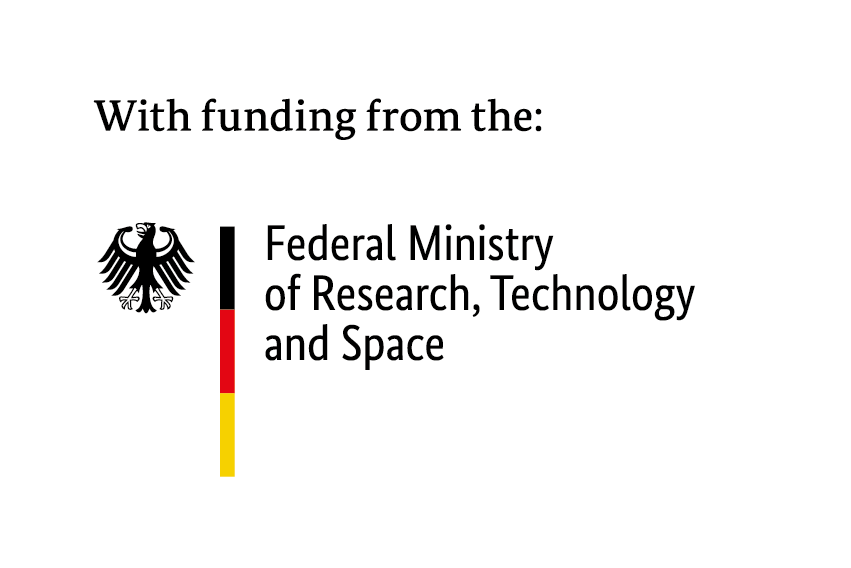
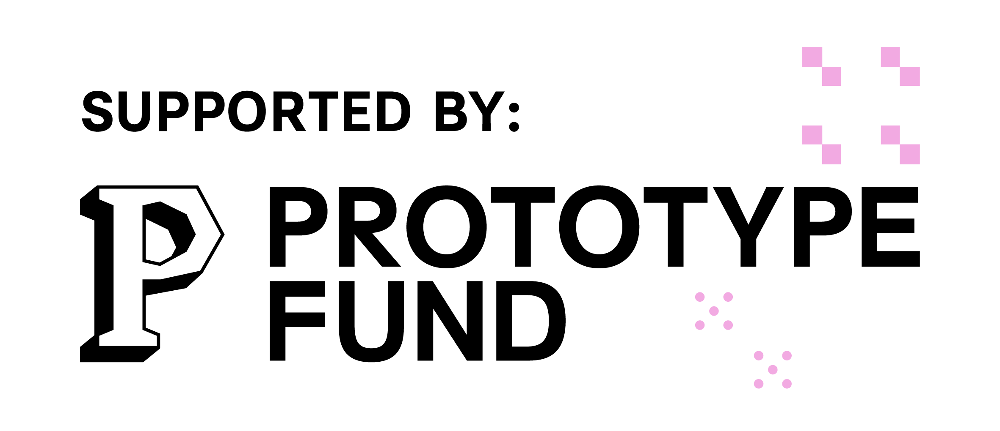

# OpenAleph OmniSearch for Obsidian

⚠️ **This plug-in is a work in progress and has not been published yet**

## Related projects

- [OpenAleph Search](https://github.com/noop-ptf/OpenAlephSearch) allows a user to search through many different OpenAleph instances simultaneously.
- [OpenAleph Explore](https://github.com/noop-ptf/OpenAlephExplore) allows users to use any note they have written to perform inverse search across multiple OpenAleph instances, and then further refine the results with terms that are very closely correlated to them.

## Team

The noop team consists of:\*\*

- Anna Główczyńska (UI/UX designer)
- Moritz Neeb (developer)
- Sabina-Alexandra Ștefănescu (developer)

The **noop** team is [active on Mastodon](https://chaos.social/@noop), and will share news about releases, demos and other tidbits. You can also follow the individual developers: [zormit](https://chaos.social/@zormit) and [catileptic](https://chaos.social/@catileptic).

## Sponsor

OpenAleph OmniSearch: an Obsidian Plug-in is funded by the German **Federal Ministry of Research, Technology and Space (BMFTR)** through the **[Prototype Fund](https://prototypefund.de)** under funding code (Förderkennzeichen) **16IS26S15**.

